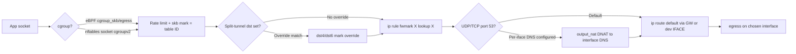

# NetWeaver

> **Per-Application Network Interface Routing, Traffic Shaping, and Failover System in Go for Linux**

NetWeaver is a Linux network utility that binds individual applications to specific network interfaces (Ethernet `eno1`, Wi-Fi `wlan0`, USB/cellular tethering `usb0`/`wwan0`, or VPN/L3 tunnels `wg0`/`tun0`) without restarting them and without changing the system's global default gateway. Applications are placed into per-interface or per-process `cgroups v2` groups; an eBPF `cgroup_skb` classifier (with automatic `nftables` fallback) marks packets with the interface's routing-table fwmark, enforces per-app token-bucket egress rate caps and kill-switch drops, and policy-based routing sends traffic out the intended uplink.

---

## Features

| Capability | Where |
|---|---|
| Per-application interface assignment (process tree aware) | daemon, TUI, CLI, dashboard |
| Zero-leak first-packet process launch (`netweaver run`) | CLI (`cmd/netweaver/run.go`) |
| Smart virtual profiles (`@low-latency`, `@high-bandwidth`, `@unmetered`, `@bulk`) | daemon, TUI, CLI, dashboard |
| RTNetlink hotplug + active upstream health probing (RTT, jitter, packet loss) | `internal/interfaces`, `internal/failover` |
| eBPF `cgroup_skb/egress` & `cgroup_skb/ingress` telemetry and token-bucket rate limiting, with `nftables` fallback | `internal/classifier` |
| Per-process policy (`failover` / `strict`) and manual block / unblock | daemon, TUI, CLI, dashboard |
| Gateway-less L3 VPN/tunnel routing & per-interface DNS DNAT isolation | `internal/routing`, `netweaver dns` |
| Domain/CIDR destination split-tunneling & background quota auto-quarantine rules | `internal/rules`, `internal/routing` |
| Daily metered interface quotas with warning/exceeded alerts and `notify-send` notifications | `internal/quota`, `internal/events` |
| One-step interface evacuation / migration (`netweaver switch`) | daemon, CLI, dashboard |
| Waybar custom module JSON (`netweaver status --waybar`) and live event stream (`netweaver events`) | CLI (`cmd/netweaver`) |
| Embedded dark bento web dashboard with live SSE event stream | `netweaver web` (`internal/web`) |

---

## Architecture

```
netweaver (unprivileged)            netweaverd (root)
┌──────────────────────┐   UDS    ┌──────────────────────────────────────┐
│ TUI (Bubbletea)      │─────────▶│ api server (/run/netweaver/*.sock)   │
│ CLI subcommands      │          │ ├ process scanner (cgroup v2 trees)  │
│ Waybar / events      │          │ ├ cgroups manager (iface + leaf pPID)│
│ web dashboard ───────┘          │ ├ routing engine (PBR, NAT, DNS, dst)│
│   (127.0.0.1:8088)              │ ├ interfaces (RTNetlink + HealthProbe)│
└──────────────────────┘          │ ├ telemetry (eBPF counters + ss/sys) │
                                  │ ├ rules store + auto-router (500ms)  │
                                  │ ├ policy (failover / strict)         │
                                  │ ├ quota manager + events bus         │
                                  │ └ eBPF classifier (egress + ingress) │
                                  └──────────────────────────────────────┘
```

- **`netweaverd`** — root daemon. Owns `cgroups v2` (`/sys/fs/cgroup/netweaver/<iface>[/p<pid>]`), `ip rule`/`ip route` tables, `nftables` NAT/DNS isolation/split-tunnel sets, telemetry sampling, RTNetlink + active health probing, daily quota tracking, the auto-routing watcher, and the eBPF classifier. Serves `/run/netweaver/netweaver.sock`.
- **`netweaver`** — unprivileged client: interactive Bubbletea TUI, CLI subcommands, Waybar status emitter, and embedded HTTP/SSE web dashboard.

### How a packet is routed



---

## Build

Requirements:
- Linux kernel 6.x+ with cgroups v2 (`/sys/fs/cgroup`)
- `nftables` (`nft`), `iproute2` (`ip`), `procps`/iproute2 `ss`
- Go (module targets Go 1.27+)
- `clang` (only needed when regenerating the eBPF object via `make bpf`)

```bash
make build   # produces bin/netweaverd and bin/netweaver
make test    # runs all unit tests
```

The compiled eBPF object (`internal/classifier/netweaver_bpfel.o`) is committed, so `clang` is not required for `make build`. Regenerate it after editing `internal/classifier/bpf/netweaver.c`:

```bash
make bpf
```

Run the full test suite with race detection:

```bash
go test -race -v ./...
```

---

## Running

### 1. Start the daemon (root)

```bash
sudo ./bin/netweaverd
```

At startup `netweaverd` discovers interfaces, assigns routing tables, creates cgroups, loads persisted rules/policies/quotas, starts the RTNetlink + active health prober, and loads the eBPF classifier (`nw_mark` + `nw_ingress`). If BPF is unavailable (insufficient privileges or kernel support), it logs a warning and falls back to `nftables` marking.

Environment overrides:

| Variable | Default | Purpose |
|---|---|---|
| `NETWEAVER_RULES` | `/etc/netweaver/rules.json` | auto-routing & split-tunnel rules |
| `NETWEAVER_SETTINGS` | `/etc/netweaver/settings.json` | global default policy (`failover` / `strict`) |
| `NETWEAVER_QUOTAS` | `/etc/netweaver/quotas.json` | metered interface flags & daily byte quotas |
| `NETWEAVER_SOCK` | `/run/netweaver/netweaver.sock` | client Unix domain socket path |

### 2. Interactive TUI

```bash
./bin/netweaver
```

Keybindings:
- `[↑/↓]` or `[j/k]` — navigate processes
- `[Enter]` — cycle selected app through active interfaces and virtual profiles (`@low-latency`, `@high-bandwidth`, `@unmetered`)
- `[Space]` — reset selected app to the default route
- `[p]` — toggle selected app's policy (`failover` ↔ `strict`)
- `[b]` — toggle manual block / unblock (`netweaver/blocked` quarantine)
- `[l]` — cycle per-app egress rate cap (`unlimited` → `256 KiB/s` → `1 MiB/s` → `5 MiB/s` → `unlimited`)
- `[P]` — toggle global default policy (`failover` ↔ `strict`)
- `[q]` / `[Ctrl+C]` — quit

The interface bar displays live health dots, `[VPN]` tags for L3 tunnels, RTT in milliseconds, ↓/↑ rates, and metered quota consumption. The process table shows PID, `[BLOCKED]` state, interface / `@profile`, policy, rate cap, ↓/↑ rates, cumulative bytes, and a 16-sample activity sparkline, alongside the latest daemon event.

### 3. Web dashboard

```bash
./bin/netweaver web                 # http://127.0.0.1:8088
./bin/netweaver web --addr :9090    # custom listen address
./bin/netweaver web --open          # open in default browser
```

### 4. CLI

```bash
# Processes (PID, interface/profile, policy, rate cap, rates, totals, [BLOCKED])
./bin/netweaver list

# Interfaces (IP, gateway, table ID, health/RTT/loss, quota, DNS)
./bin/netweaver interfaces

# Manual assignment (real interface or smart virtual profile)
./bin/netweaver assign 1234 wlan0
./bin/netweaver assign 1234 @low-latency strict --rate 2MiB/s
./bin/netweaver assign 1234 @unmetered --strict
./bin/netweaver reset 1234

# Manual block / unblock (never auto-released by link failover)
./bin/netweaver block 1234
./bin/netweaver unblock 1234

# Evacuate / migrate all processes from one interface to another (or best available)
./bin/netweaver switch wlan0 eno1
./bin/netweaver switch wlan0

# Zero-leak first-packet launch (wrapper enters target cgroup BEFORE exec)
./bin/netweaver run -i wlan0 curl -4 https://api.ipify.org
./bin/netweaver run -i wg0 --strict --rate 1MiB/s firefox

# Auto-routing, split-tunneling, and background quota rules
./bin/netweaver rules list
./bin/netweaver rules add firefox @low-latency strict
./bin/netweaver rules add 'steam*' @high-bandwidth --rate 10MB/s --background
./bin/netweaver rules add curl wg0 strict --domains 198.51.100.0/24,*.corp.internal
./bin/netweaver rules remove firefox
./bin/netweaver rules clear

# Global default failover policy
./bin/netweaver policy
./bin/netweaver policy set strict

# Daily metered quotas (accepts B, K/KiB, KB, M/MiB, MB, G/GiB, GB, T/TiB, TB)
./bin/netweaver quota list
./bin/netweaver quota set wwan0 1.5GB --warn 80 --metered
./bin/netweaver quota remove wwan0

# Per-interface DNS isolation (port-53 DNAT)
./bin/netweaver dns set wg0 1.1.1.1,9.9.9.9
./bin/netweaver dns get wg0
./bin/netweaver dns set wg0 clear

# Daemon status & Waybar JSON output
./bin/netweaver status
./bin/netweaver status --waybar

# Event history & live stream (with optional desktop notifications via notify-send)
./bin/netweaver events
./bin/netweaver events --follow --notify
```

Rule match syntax:

| Pattern | Matches |
|---|---|
| `firefox` | process name (`comm`) only — the browser process group |
| `bin:firefox` | `argv[0]` basename, including browser helper processes |
| `cmd:*-silent` | the full command line |

#### Waybar custom module example

```jsonc
"custom/netweaver": {
  "exec": "/path/to/bin/netweaver status --waybar",
  "return-type": "json",
  "interval": 2
}
```

---

## Smart Profiles, Health Probing, Quotas & Failover Policies

- **Smart virtual profiles**:
  - `@low-latency` — prefers healthy unmetered non-tunnel links with the highest health score and lowest `LatencyMs + JitterMs`.
  - `@high-bandwidth` / `@bulk` — prefers healthy unmetered, under-quota interfaces ordered by link priority.
  - `@unmetered` — selects only healthy interfaces that are neither metered nor quota-exceeded (returns an error under `failover` or quarantines into `blocked` under `strict` if none qualify).
  - Virtual-profile assignments are dynamically re-evaluated whenever links, upstream health, or quota states change.
- **Policies on link loss or upstream failure**:
  - **`failover`** (default) — moves processes to the best healthy surviving interface using priority order Ethernet (`50`) > Wi-Fi (`100`) > Other (`200`) > VPN/Tunnel (`400`) > USB/Metered (`700`).
  - **`strict`** — quarantines processes into `netweaver/blocked` so the classifier (eBPF or `nftables`) drops all packets rather than leaking onto another link. Released automatically when the interface returns healthy (and within quota).
  - **Active upstream probing** — detects "carrier up, upstream dead" conditions after consecutive probe failures (`FailThreshold = 3`) and evacuates without thrashing until upstream health recovers.
  - **Manual blocks** (`netweaver block`) are tracked separately from failover/quota quarantines and are never auto-unblocked on link recovery.
- **Metered quotas**:
  - Tracks daily byte deltas per interface with automatic midnight rollover.
  - At warning threshold (`--warn`, default `80%`), emits `quota_warn` + desktop notification; when exceeded, emits `quota_exceeded` + desktop notification and auto-quarantines processes matching `Background: true` rules on that interface.

---

## Demonstration for College Evaluation / Viva

0. **Verify the eBPF classifier on the live kernel (root)**
   ```bash
   sudo ./scripts/verify-ebpf.sh
   ```
   Loads the daemon, confirms `nw_mark` is attached to interface cgroups, dumps `nw_targets`, and checks clean shutdown.

1. **Show the routing & eBPF state**
   ```bash
   ip rule show
   ip route show table all
   sudo nft list ruleset
   sudo bpftool prog show            # eBPF classifier, when active
   sudo bpftool map dump name nw_targets
   sudo bpftool map dump name nw_ratelimits
   sudo bpftool map dump name nw_stats
   ```

2. **Two uplinks without physical cables**
   ```bash
   sudo scripts/setup-veth-test.sh
   ```

3. **Prove per-application egress & zero-leak launch**
   ```bash
   ./bin/netweaver assign <pid-of-terminal-A> wlan0
   ./bin/netweaver assign <pid-of-terminal-B> enp5s0f4u2
   ./bin/netweaver run -i wlan0 --strict curl -4 https://api.ipify.org
   sudo tcpdump -i wlan0 -n
   ```

4. **Prove the kill-switch**
   ```bash
   ./bin/netweaver rules add firefox wlan0 strict
   ip link set wlan0 down             # firefox traffic is dropped, not leaked
   ```
