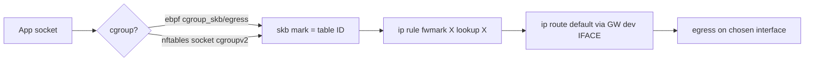

# NetWeaver

> **Per-Application Network Interface Routing System in Go for Linux**

NetWeaver is a Linux network utility that binds individual applications to specific network interfaces (Ethernet `eno1`, Wi-Fi `wlan0`, USB tethering `enp5s0f4u2`/`usb0`) without restarting them and without changing the system's global default gateway. Applications are moved into per-interface `cgroups v2` groups; an eBPF (or nftables) classifier stamps each packet with the interface's routing-table mark, and policy-based routing sends it out the intended link.

---

## Features

| Capability | Where |
|---|---|
| Per-application interface assignment (process tree aware) | daemon, TUI, CLI, dashboard |
| Live download/upload rates, cumulative usage, activity sparklines | TUI, dashboard |
| Per-interface throughput and totals | TUI, dashboard |
| Persistent auto-routing rules applied at process launch | `rules.json`, `netweaver rules` |
| Interface priority: Ethernet > Wi-Fi > USB tethering | always enforced |
| IPv6 policy routing with leak prevention (`unreachable` in empty tables) | routing engine |
| Failover policy: move traffic to the best surviving interface | interface watcher |
| Strict policy: kill-switch, traffic quarantined and dropped | `netweaver policy` |
| eBPF `cgroup_skb/egress` classifier with automatic nftables fallback | `internal/classifier` |
| Embedded web dashboard (no external assets) | `netweaver web` |

---

## Architecture

```
netweaver (unprivileged)            netweaverd (root)
┌──────────────────────┐   UDS    ┌──────────────────────────────┐
│ TUI (Bubbletea)      │─────────▶│ api server                   │
│ CLI subcommands      │          │ ├ process scanner            │
│ web dashboard ───────┘          │ ├ cgroups manager            │
│   (127.0.0.1:8088)              │ ├ routing engine (PBR, NAT)   │
└──────────────────────┘          │ ├ telemetry (rates, usage)   │
                                  │ ├ rules store + auto-router   │
                                  │ ├ policy (failover/strict)    │
                                  │ └ eBPF classifier             │
                                  └──────────────────────────────┘
```

- **`netweaverd`** — root daemon. Owns `cgroups v2` (`/sys/fs/cgroup/netweaver/<iface>`), `ip rule`/`ip route` tables, nftables NAT, telemetry sampling, the auto-routing watcher, and the eBPF classifier. Serves `/run/netweaver/netweaver.sock`.
- **`netweaver`** — unprivileged client: TUI, CLI, and the web dashboard.

### How a packet is routed



---

## Build

Requirements:
- Linux kernel 6.x+ with cgroups v2 (`/sys/fs/cgroup`)
- `nftables` (`nft`), `iproute2` (`ip`), `procps`/iproute2 `ss`
- Go 1.22+

```bash
make build   # produces bin/netweaverd and bin/netweaver
make test
```

The eBPF object (`internal/classifier/netweaver_bpfel.o`) is committed, so `clang` is not required to build. Regenerate it after editing `internal/classifier/bpf/netweaver.c`:

```bash
make bpf
```

---

## Running

### 1. Start the daemon (root)
```bash
sudo ./bin/netweaverd
```
At startup it discovers interfaces, assigns routing tables, creates cgroups, and tries to load the eBPF classifier. If BPF is unavailable (no privileges or kernel support) it logs a warning and keeps using nftables marking.

Environment overrides:

| Variable | Default | Purpose |
|---|---|---|
| `NETWEAVER_RULES` | `/etc/netweaver/rules.json` | auto-routing rules |
| `NETWEAVER_SETTINGS` | `/etc/netweaver/settings.json` | default policy |
| `NETWEAVER_SOCK` | `/run/netweaver/netweaver.sock` | client socket path |

### 2. Interactive TUI
```bash
./bin/netweaver
```
- `[↑/↓]` / `[j/k]` navigate
- `[Enter]` cycle the selected app through interfaces
- `[Space]` return the app to the default route
- `[q]` quit

Rows show PID, application, interface, policy, live ↓/↑ rates, cumulative usage, and a 16-sample activity sparkline.

### 3. Web dashboard
```bash
./bin/netweaver web                 # http://127.0.0.1:8088
./bin/netweaver web --open          # open in the browser
```

### 4. CLI
```bash
# Processes and their interfaces
./bin/netweaver list

# Interfaces with rates, gateways and table IDs
./bin/netweaver interfaces

# Manual assignment
./bin/netweaver assign 1234 wlan0
./bin/netweaver reset 1234
./bin/netweaver run -i wlan0 firefox

# Auto-routing rules (matched on process name)
./bin/netweaver rules list
./bin/netweaver rules add firefox wlan0 strict
./bin/netweaver rules add 'steam*' eno1
./bin/netweaver rules remove firefox
./bin/netweaver rules clear

# Default policy for unassigned/strict handling
./bin/netweaver policy
./bin/netweaver policy set strict
```

Rule match syntax:

| Pattern | Matches |
|---|---|
| `firefox` | process name (`comm`) only — the browser process group |
| `bin:firefox` | `argv[0]` basename, including browser helper processes |
| `cmd:*-silent` | the full command line |

---

## Policies on interface loss

When an interface disappears (cable unplugged, tethering stopped):

- **failover** (default) — processes move to the best surviving interface using the priority order Ethernet (`50`) > Wi-Fi (`100`) > USB tethering (`700`). No survivor means the process stays put with no route.
- **strict** — processes are moved to the `netweaver/blocked` quarantine cgroup; the classifier (eBPF or nftables) drops their packets so nothing leaks onto another link. They are released back to their interface when it returns.

Rule-specific policy overrides the global default; explicit assignments capture the resolved policy at assignment time.

---

## Demonstration for College Evaluation / Viva

0. **Verify the eBPF classifier on the live kernel (root)**
   ```bash
   sudo ./scripts/verify-ebpf.sh
   ```
   Loads the daemon, confirms `nw_mark` is attached to every interface cgroup,
   dumps the mark map, and checks that shutdown removes the nftables table.

1. **Show the routing state**
   ```bash
   ip rule show
   ip route show table all
   sudo nft list ruleset
   sudo bpftool prog show            # eBPF classifier, when active
   sudo bpftool map dump name nw_targets
   ```

2. **Two uplinks without physical cables**
   ```bash
   sudo scripts/setup-veth-test.sh
   ```

3. **Prove per-application egress**
   ```bash
   ./bin/netweaver assign <pid-of-terminal-A> wlan0
   ./bin/netweaver assign <pid-of-terminal-B> enp5s0f4u2
   curl -4 https://api.ipify.org      # in terminal A
   curl -4 https://api.ipify.org      # in terminal B -> different public IP
   sudo tcpdump -i wlan0 -n
   ```

4. **Prove the kill-switch**
   ```bash
   ./bin/netweaver rules add firefox wlan0 strict
   ip link set wlan0 down             # firefox traffic is dropped, not leaked
   ```
